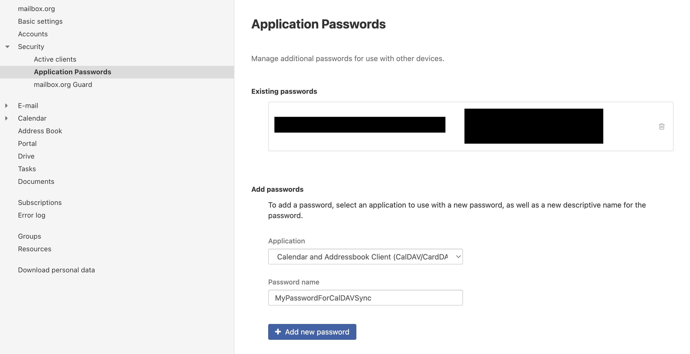
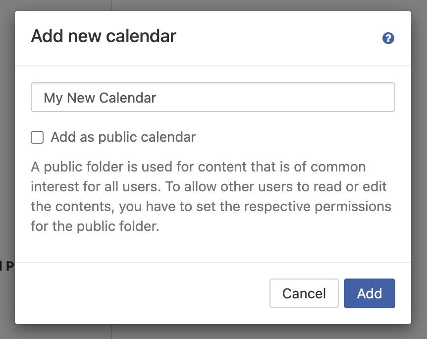
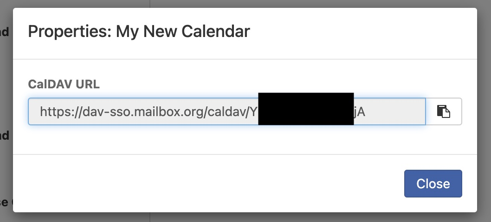

[paypal]: https://paypal.me/GerdNaschenweng

# 📅 calendar-sync


[](https://github.com/magicdude4eva/calendar-sync/commits/master)


`calendar-sync` is a flexible utility to sync one or more ICS feeds (iCalendar) into a CalDAV-compatible calendar — ideal for mailbox.org, Nextcloud, Synology, and more.

It supports features such as:
- ✅ Deterministic UID generation for clean deduplication
- 📅 Emoji mapping for more readable calendar events
- 🔁 Automatic expansion of recurring events (daily, weekly, monthly, yearly, …)
- 🔁 Full support for recurring events (e.g., yearly holidays) and custom extra events (Mother's Day, Advent Sundays, etc.)
- 🧼 Cleanup mode with multi-prefix support (`--cleanup PREFIX1,PREFIX2`)
- 🧹 Optional removal of rescheduled or cancelled events per feed (`remove_stale`), keeping your history
- 🔄 Optional in-place updates when a feed changes an event's details (`update_existing`)
- 📍 Location-based filtering (e.g., for regional holidays in Austria)
- 🔍 Event title filtering with regex (include/exclude patterns)
- 🐳 Docker deployment for simple automation
- 💡 Dry-run mode to preview changes without writing
- 🕓 Timezone-aware handling for accurate scheduling

This is perfect for importing:
- 🗑️ Municipal waste collection schedules (e.g., Müll App)
- 🇦🇹 Austrian public holidays
- 🏎️ Formula 1 calendar with free practice, qualifying, and GP events

Unlike subscription-based ICS calendars, this tool **writes events directly into your calendar**, giving you full control over notifications, offline visibility, and data retention.

Use it on your Synology NAS, a server, or as a cron-triggered Docker container — and never miss a bin collection or Grand Prix again.


<video src="https://github.com/user-attachments/assets/59d1b6f4-32ad-4133-8826-021ca2ea3030" autoplay muted loop></video>


___

🍺 **Please support me**: Although all my software is free, it is always appreciated if you can support my efforts on Github with a [contribution via Paypal][paypal] - this allows me to write cool projects like this in my personal time and hopefully help you or your business. 


---

## ✨ Features

- 🔁 Sync multiple ICS feeds to any CalDAV calendar
- 🧠 Deterministic UID generation & deduplication
- 🔁 Automatic expansion of all recurring events (`RRULE`, `RDATE`, `EXDATE`, moved occurrences)
- 📍 Location-based filtering for region-specific holidays
- 🔍 Event title filtering with regex patterns (include/exclude)
- 🧹 Optional cleanup of old imported events
- 📅 Supports emoji mapping for event names
- 🛑 Dry run mode to test before writing
- 🐳 Docker support for simple deployment

---

## 🚀 Usage

### Manual

```bash
# Default config file (config.json)
python src/calendar_sync.py --import
python src/calendar_sync.py --import --dry-run
python src/calendar_sync.py --cleanup # cleans global prefix
python src/calendar_sync.py --cleanup MUELL-,F1- # cleans multiple prefixes

# Custom config file
python src/calendar_sync.py --import --config /path/to/another_config.json
python src/calendar_sync.py --import --dry-run --config /path/to/another_config.json
python src/calendar_sync.py --cleanup --config /path/to/another_config.json
```

### With Docker Compose

A ready-made image for `linux/amd64` and `linux/arm64` is published to the GitHub Container Registry with every release: `ghcr.io/magicdude4eva/calendar-sync` (tags: `latest` and each release, e.g. `v1.5.0`).

You only need a `docker-compose.yml` and your `config.json` in one directory:

```yaml
services:
  calendar-sync:
    image: ghcr.io/magicdude4eva/calendar-sync:latest
    volumes:
      - ./config.json:/app/config.json:ro
    command: ["--import"]
```

Fetch the latest image (do this before each run, e.g. in your scheduled task, to stay up to date):

```bash
docker-compose pull
```

To build the image yourself from a clone of this repository instead, use `docker-compose build`.

Then run the sync:

```bash
# Default config file
docker-compose run --rm calendar-sync --import
docker-compose run --rm calendar-sync --import --dry-run
docker-compose run --rm calendar-sync --cleanup

# Custom config file (mount the config file into the container)
docker-compose run --rm -v /path/to/another_config.json:/app/config.json calendar-sync --import
docker-compose run --rm -v /path/to/another_config.json:/app/config.json calendar-sync --import --dry-run
docker-compose run --rm -v /path/to/another_config.json:/app/config.json calendar-sync --cleanup
```

---

## 🧰 Manual Installation

```bash
git clone https://github.com/magicdude4eva/calendar-sync.git
cd calendar-sync
python3.14 -m venv .venv
source .venv/bin/activate
pip install -r requirements.txt
```

---

## ⚙️ Configuration

You can use multiple config files to manage different calendars. By default, the script uses `config.json`. To use a different config file, pass it via the `--config` argument:

```bash
python src/calendar_sync.py --import --config /path/to/another_config.json
```

Example config:
```json
{
  "caldav_url": "https://dav-sso.mailbox.org/caldav/...",
  "username": "your@email.com",
  "password": "your-app-password",
  "timezone": "Europe/Vienna",
  "uid_prefix": "ICS-",
  "future_event_limit_days": 365,
  "ics_feeds": [
    {
      "url": "https://example.com/my.ics",
      "uid_prefix": "EXAMPLE-",
      "emoji_mapping": {
        "Papier": "♻️",
        "default": "📦"
      },
      "default_reminder": "1d"
    },
    {
      "url": "https://example.com/sports.ics",
      "uid_prefix": "SPORTS-",
      "filter": {
        "exclude": ["Preliminary", "Qualifying", "Practice"]
      }
    }
  ]
}
```

---

## 🛠️ How It Works

- Fetches events from each configured ICS feed
- Normalizes dates and checks if the UID exists
- Skips, adds, or replaces events as needed
- Uses emoji mappings to prefix event names
- All-day events are handled properly (no time zone shift)
- Recurring events are expanded into individual occurrences within the sync window
- Events can be filtered by `LOCATION` using `import_locations`

🗺️ For `import_locations`, configure it per feed. For example:

```json
{
  "url": "https://www.feiertage-oesterreich.at/kalender-download/ics/feiertage-oesterreich.ics",
  "import_locations": "K,St,V",
  "emoji_mapping": {
    "§": "🇦🇹",
    "default": "🗓️"
  }
}
```

To discover valid locations, run the sync once and check the logs. Example:
```
INFO: ⏭️ Skipping 'St. Florian' (2025-05-04) due to unmatched location: OÖ
```

### 🔍 Event Title Filtering

Filter events based on their title using regex patterns. You can either **include** only matching events or **exclude** matching events. These modes are mutually exclusive — you cannot use both at the same time for the same feed.

**Configuration:**
```json
{
  "url": "https://example.com/calendar.ics",
  "uid_prefix": "FILTERED-",
  "filter": {
    "include": ["Tournament Finals", "Grand Slam"]
  }
}
```

```json
{
  "url": "https://example.com/calendar.ics",
  "uid_prefix": "FILTERED-",
  "filter": {
    "exclude": ["Preliminary", "Qualifying", "Practice"]
  }
}
```

**Regex Examples:**

| Pattern | Matches | Description |
|---------|---------|-------------|
| `"Tournament Finals"` | Events containing "Tournament Finals" | Simple substring match |
| `"^Final:"` | Events starting with "Final:" | Anchored at start |
| `"(Prelim|Semi|Quarter)"` | Events containing any of these words | OR logic with grouping |
| `"2026"` | Events containing "2026" | Year filtering |
| `"(Grand Prix|World Cup)"` | Events containing either phrase | Multiple patterns |
| `".*Championship.*"` | Events with "Championship" anywhere | Flexible matching |
| `"^[A-Z].*"` | Events starting with uppercase letter | Pattern at start |

**How it works:**
- **Include mode**: Only events matching at least one pattern are imported
- **Exclude mode**: Events matching any pattern are skipped
- **Mutually exclusive**: If both `include` and `exclude` are present, both are ignored with a warning
- **Applied early**: Filtering happens before emoji mapping and other processing
- **Per-feed**: Each feed can have its own filter configuration

### 📱 Emoji Mapping

Emoji mapping allows you to prefix event titles with emojis for better visual organization in your calendar. This is particularly useful when syncing multiple ICS feeds to distinguish between different event types at a glance.

### 🏷️ Categories Support

Categories allow you to organize and filter events in your calendar client. The `categories` configuration provides comprehensive control over how event categories are handled:

The `categories` object in your feed configuration supports multiple operations:

| Option | Type | Description | Example |
|--------|------|-------------|---------|
| `append` | Array | Add categories to the end of existing ones | `["Imported", "Synced"]` |
| `prepend` | Array | Add categories to the beginning of existing ones | `["Custom"]` |
| `remove` | Array | Remove unwanted categories | `["SPAM", "ADVERTISING"]` |
| `replace_if_empty` | Array | Replace all categories if event has none | `["Default"]` |
| `deduplicate` | Boolean | Remove duplicate categories (default: `true`) | `true` or `false` |

#### **How Categories Work**

1. **Upstream categories** are preserved from the ICS feed
2. **Custom categories** are added based on your configuration
3. **Filtering** removes unwanted categories
4. **Deduplication** ensures each category appears only once

#### **Category Processing Order**

1. Start with upstream categories from the ICS feed (if any)
2. Apply `replace_if_empty` if event has no categories and this is configured
3. Apply `prepend` categories (added to beginning)
4. Apply `append` categories (added to end)
5. Apply `remove` filtering
6. Deduplicate if enabled

#### **Examples**

**Example 1: Adding custom categories**
```json
{
  "url": "https://example.com/my.ics",
  "categories": {
    "append": ["Imported", "Synced"]
  }
}
```
**Result**: Events get their original categories + "Imported" and "Synced"

**Example 2: Filtering unwanted categories**
```json
{
  "url": "https://example.com/third-party.ics",
  "categories": {
    "append": ["Imported"],
    "remove": ["SPAM", "ADVERTISING", "Third-Party"]
  }
}
```
**Result**: Events get original categories + "Imported", minus any unwanted ones

**Example 3: Replacing empty categories**
```json
{
  "url": "https://example.com/empty-categories.ics",
  "categories": {
    "replace_if_empty": ["Default Category"],
    "append": ["Synced Events"]
  }
}
```
**Result**: Events with no categories get ["Default Category", "Synced Events"]

**Example 4: Prepending categories**
```json
{
  "url": "https://example.com/priority.ics",
  "categories": {
    "prepend": ["High Priority", "Important"]
  }
}
```
**Result**: Events get ["High Priority", "Important"] + original categories

**Example 5: Complete control**
```json
{
  "url": "https://example.com/clean.ics",
  "categories": {
    "prepend": ["Custom"],
    "append": ["Imported"],
    "remove": ["SPAM"],
    "deduplicate": true
  }
}
```
**Result**: Full control over category composition with deduplication

#### **Use Cases**

- **Identify synced events**: Add "Imported" or "Synced" to all events
- **Filter spam**: Remove unwanted categories like "SPAM" or "ADVERTISING"
- **Organize by type**: Add categories like "Holidays", "Sports", "Work"
- **Clean up third-party feeds**: Remove feed-specific spam categories
- **Standardize categories**: Ensure consistent categorization across feeds

#### **Client-Side Coloring**

Many calendar clients (Thunderbird, Evolution, etc.) support **category-based coloring**:
- Events with the same category share the same color
- You can configure your client to assign specific colors to specific categories
- This provides visual organization without modifying the event data

**Note**: Color assignment is client-specific and not part of the CalDAV standard. See your calendar client's documentation for details.

**Example Thunderbird setup**:
1. Go to Calendar Properties
2. Select "Categories" tab
3. Assign colors to each category
4. Events will automatically use those colors

**Reference**: [Thunderbird Calendar Categories](https://support.mozilla.org/en-US/kb/calendar-categories)  

### 🎨 Event Colors (RFC 7986)

You can assign colors to individual events using the `calendar_color` property in your feed configuration. This follows the [RFC 7986](https://icalendar.org/New-Properties-for-iCalendar-RFC-7986/5-9-color-property.html) standard for iCalendar color properties.

#### **Color Configuration**

Add `calendar_color` to any feed configuration:

```json
{
  "url": "https://example.com/my.ics",
  "calendar_color": "#FF5733",  // Orange-red color
  "categories": {
    "append": ["Important"]
  }
}
```

#### **Supported Color Formats**

| Format | Example | Description |
|--------|---------|-------------|
| Hex (3-digit) | `#RGB` | `#F00` for red |
| Hex (6-digit) | `#RRGGBB` | `#FF5733` for orange-red |
| Color name | `red`, `blue`, `green` | Standard color names |

#### **Color Examples**

```json
{
  "ics_feeds": [
    {
      "url": "https://app.muellapp.com/ical/74418",
      "calendar_color": "#4CAF50",  // Green for waste collection
      "categories": {
        "append": ["Waste Collection", "Municipal"]
      }
    },
    {
      "url": "https://feiertage-oesterreich.at/kalender-download/ics/feiertage-oesterreich.ics",
      "calendar_color": "#FF5733",  // Orange for holidays
      "categories": {
        "prepend": ["Austrian"]
      }
    },
    {
      "url": "https://better-f1-calendar.vercel.app/api/calendar.ics",
      "calendar_color": "#2196F3",  // Blue for F1 racing
      "categories": {
        "append": ["Sports", "Racing"]
      }
    }
  ]
}
```

#### **How It Works**

1. The `calendar_color` property is added to each event from the feed
2. The color is embedded in the iCalendar data (RFC 7986 compliant)
3. Modern CalDAV clients that support RFC 7986 will display these colors
4. The color assignment is per-event and can vary by feed

#### **Client Support**

- ✅ **Thunderbird**: Supports RFC 7986 color property
- ✅ **Evolution**: Supports RFC 7986 color property
- ✅ **Nextcloud Calendar**: Supports RFC 7986 color property
- ❌ **mailbox.org**: The server drops the `COLOR` property when events are saved, so per-event colours are not stored. Use a separate calendar per feed, or categories with client-side colouring, instead.
- ⚠️ **Some mobile clients**: May not support RFC 7986 yet

**Note**: Even if a client doesn't support RFC 7986, the color information is stored in the event (unless the server drops it) and won't cause issues.

#### **Fallback Behavior**

If your CalDAV client doesn't support RFC 7986 color properties, the events will still be created normally. The color information will be embedded in the event data but may be ignored by the client.

#### **Use Cases**

- **Visual organization**: Different feeds use different colors
- **Quick identification**: Waste collection vs holidays vs sports events
- **Calendar segmentation**: Each type of event has its own color
- **Client-side filtering**: Use colors to identify event categories

#### **Limitations**

- Color assignment is client-dependent
- Not all CalDAV clients support RFC 7986 yet
- Colors may not be visible in all calendar applications
- The color property is additional metadata, not required for functionality

**How it works:**

The `emoji_mapping` object in your feed configuration uses **event title matching** to determine which emoji to prepend to an event:

1. **Exact key matching**: The script checks if any key in the `emoji_mapping` object matches part of the event's title
2. **Prepending**: When a match is found, the corresponding emoji is prepended to the event title
3. **Fallback**: If the event title doesn't match any configured keys, the `"default"` emoji is used
4. **Case-sensitive**: Matching is case-sensitive

**Key points:**

- The `emoji_mapping` object accepts any string as a key (words, phrases, special characters, etc.)
- The `"default"` key is a special reserved field that serves as a fallback emoji when no other keys match
- Values must be emojis or text that will be prepended to the event title
- You can configure multiple mappings per feed

**Examples:**

```json
{
  "url": "https://example.com/waste.ics",
  "emoji_mapping": {
    "Papier": "♻️",
    "Plastik": "🟡",
    "Glas": "🟢",
    "Restmüll": "⚫",
    "default": "🗑️"
  }
}
```

With the above configuration, an event titled "Papier Collection" would become "♻️ Papier Collection", while an unknown event type would become "🗑️ Unknown Event".

**Another example (Austrian holidays):**

```json
{
  "url": "https://www.feiertage-oesterreich.at/kalender-download/ics/feiertage-oesterreich.ics",
  "emoji_mapping": {
    "Ostern": "🐰",
    "Weihnachten": "🎄",
    "Neujahr": "🎆",
    "§": "🇦🇹",
    "default": "🗓️"
  }
}
```

### ⏰ Default Reminder Format

The `default_reminder` field specifies when you should receive a notification for imported events. It uses a duration format with unit suffixes:

| Format  | Meaning |
|---------|---------|
| `15m`   | 15 minutes before the event |
| `1h`    | 1 hour before the event |
| `1d`    | 1 day before the event |
| `2d`    | 2 days before the event |
| `1w`    | 1 week before the event |

- **`m`** = minutes
- **`h`** = hours
- **`d`** = days
- **`w`** = weeks

**Examples:**

```json
{
  "ics_feeds": [
    {
      "url": "https://example.com/my.ics",
      "default_reminder": "15m"   // Notify 15 minutes before
    },
    {
      "url": "https://example.com/holidays.ics",
      "default_reminder": "1d"    // Notify 1 day before
    },
    {
      "url": "https://example.com/formula1.ics",
      "default_reminder": "2h"    // Notify 2 hours before
    }
  ]
}
```

### 🗓️ Support for Recurring Events
Recurring events in a feed are expanded into individual events for every occurrence between two weeks ago and the configured future limit (`future_event_limit_days`). Expansion uses [`recurring-ical-events`](https://github.com/niccokunzmann/python-recurring-ical-events), so it follows RFC 5545:

- Any `RRULE` frequency (daily, weekly, monthly, yearly) including `INTERVAL`, `COUNT`, `UNTIL` and `BYDAY`-style rules
- Extra dates (`RDATE`) and cancelled dates (`EXDATE`)
- Single occurrences that were moved or renamed (`RECURRENCE-ID`)
- Dates that do not exist in a given year (e.g. 29 February) are skipped

Each occurrence becomes its own event with a UID derived from its title and start time, so filters, emoji mapping, categories and deduplication work per occurrence. Reminders defined on the recurring event are copied to every occurrence.

> **Note:** Unbounded rules (e.g. a daily event with no end) create one event per occurrence up to `future_event_limit_days`. Lower that limit for feeds with frequent recurring events.

### 🧹 Removing Stale Events (`remove_stale`)
By default, events are only ever added. If a feed reschedules or cancels an event, the old copy stays in your calendar. Set `"remove_stale": true` on a feed to remove events the feed no longer contains:

```json
{
  "url": "https://example.com/hockey.ics",
  "uid_prefix": "HOCKEY-",
  "remove_stale": true
}
```

After importing the feed, every calendar event with that feed's `uid_prefix` is compared against the events the feed currently produces. An event is removed only if **all** of these apply:

- its UID starts with the feed's `uid_prefix`
- it is no longer in the feed, or is now excluded by `filter` / `import_locations`
- it has **not started yet** and starts within `future_event_limit_days`

Past events are never removed, so your history is kept even for feeds that drop past events.

**Safety checks:**
- Nothing is removed if the feed cannot be downloaded or parsed, or if it suddenly contains no events at all in the sync window (usually a temporary problem on the provider's side).
- `remove_stale` requires a `uid_prefix` that is unique to the feed. It is refused (and reported as an error) if the prefix is the global `uid_prefix` used by `extra_events`, is shared with another feed, or overlaps with one (e.g. `F1-` and `F1-SPRINT-`).
- Use `--dry-run` first to see what would be removed.

> **Tip:** If you add a `filter` to an existing feed, `remove_stale` also removes upcoming events that were imported before and are now filtered out.

This replaces the need to run `--cleanup` before every `--import`.

### 🔄 Updating Changed Events (`update_existing`)
Events are identified by their title and start time. If a feed changes anything else about an event (end time, location, description, URL, categories, reminders), the copy in your calendar stays outdated by default. Set `"update_existing": true` on a feed to update such events in place:

```json
{
  "url": "https://example.com/hockey.ics",
  "uid_prefix": "HOCKEY-",
  "update_existing": true
}
```

This also applies configuration changes to events that were already imported, e.g. a new `emoji_mapping`, `categories`, `calendar_color` or `default_reminder`.

**How it works:**
- Each event already in your calendar is compared with what the feed produces now. Only meaningful content is compared: start, end, title, description, location, URL, organizer, categories, colour and reminder triggers. Timestamps, `SEQUENCE` and properties added by your server or client are ignored.
- Changed events are updated in place: the UID and creation time are kept and `SEQUENCE` is increased, so calendar apps pick up the change.
- `--dry-run` lists what would be updated and which fields changed.
- Colours are only compared if your server stores them (mailbox.org, for example, drops `COLOR`).

> **Note:** Updates overwrite the event, including changes you made to it by hand in your calendar app (e.g. an extra reminder). Leave this option off for feeds whose events you edit manually.

A change to an event's **title or start time** creates a new event instead (its identity changed). Combine with `remove_stale` to have the old copy removed.

### ➕ Support for Custom Extra Events
In addition to ICS feeds, you can define your own custom events using the `extra_events` entry in `config.json`.

This allows you to add things like:

- 🌷 Mother's Day (2nd Sunday of May)
- 👨‍👧‍👦 Father's Day (2nd Sunday of June)
- 🔥 Summer Solstice (21st June)
- 🎃 Halloween (31st October)
- 🕯️ Advent Sundays
- 🧾 Tax Deadlines
- ☀️ Daylight Saving Time changes

**Supported Formats:**

| Format                     | Description                                 | Example                   |
|----------------------------|---------------------------------------------|---------------------------|
| `N.Weekday.Month`          | Nth weekday of a month                      | `2.Sunday.5` → 2nd Sunday in May |
| `-N.Weekday.Month`         | Nth weekday from end of month               | `-1.Sunday.3` → last Sunday in March |
| `DD.MM.fixed`              | Fixed date                                  | `31.10.fixed` → 31st October     |
| `N.Weekday.before.DD.MM`   | Nth weekday before a date (date excluded)   | `1.Sunday.before.25.12` → 4th Advent |
| `N.Weekday.after.DD.MM`    | Nth weekday after a date (date excluded)    | `1.Thursday.after.20.11` → Thursday after 20th November |

**Sample:**

```json
    "extra_events": [
      "☀️ Sommerzeit beginnt:-1.Sunday.3",
      "🌷 Muttertag:2.Sunday.5",
      "👨‍👧‍👦 Vatertag:2.Sunday.6",
      "🔥 Sonnwendfeier:21.6.fixed",
      "🧾 Steuererklärung:30.6.fixed",
      "🌒 Sommerzeit endet:-1.Sunday.10",
      "🎃 Halloween:31.10.fixed",
      "🕯️ 1. Advent:4.Sunday.before.25.12",
      "🕯️ 2. Advent:3.Sunday.before.25.12",
      "🕯️ 3. Advent:2.Sunday.before.25.12",
      "🕯️ 4. Advent:1.Sunday.before.25.12",
      "👹 Krampusnacht:5.12.fixed",
      "🎅 Nikolaus:6.12.fixed"    
      ],
```

---

## 🧪 Dry Run

Add `--dry-run` to see what would happen without making changes:

```bash
docker-compose run --rm calendar-sync --import --dry-run
```

---

## 🗂️ Project Structure

```
calendar-sync/
├── src/
│   ├── calendar_sync.py      # Entry script
│   └── utils.py              # Core sync logic
├── tests/                    # pytest suite (no network or CalDAV server needed)
├── config.json               # Configuration
├── Dockerfile
├── docker-compose.yml
├── requirements.txt
├── requirements-dev.txt      # Test dependencies
└── README.md
```

---

## 🧪 Running Tests

The test suite uses an in-memory CalDAV calendar and fake ICS feeds, so it runs offline and never touches a real calendar:

```bash
pip install -r requirements-dev.txt
python -m pytest
```

Tests also run automatically on every push and pull request via GitHub Actions.

---

## 📷 mailbox.org Setup Guide

### 1. 🔐 Create Application Password  
Go to `Settings → Security → Application Passwords`  
Select **Calendar and Addressbook Client (CalDAV/CardDAV)**  


---

### 2. 📅 Create a New Calendar  
Go to the **Calendar** section → click `+ Add new calendar`  


---

### 3. 🔗 Get the CalDAV URL  
Right-click your new calendar → `Properties` → Copy the URL  


Paste it into `config.json` under `"caldav_url"`
---

## 📄 License
This project is licensed under the [MIT License](LICENSE).

---

## ❤️ Contributing
PRs welcome! File issues or ideas via GitHub.

## Donations are always welcome

[paypal]: https://paypal.me/GerdNaschenweng

🍻 **Support my work**  
All my software is free and built in my personal time. If it helps you or your business, please consider a small donation via [PayPal][paypal] — it keeps the coffee ☕ and ideas flowing!

💸 **Crypto Donations**  
You can also send crypto to one of the addresses below:

```
(BTC)   bc1qdgdkk7l98pje8ny9u4xavsvrea8dw6yu8jpnyf
(ETH)   0x5986f713A538D6bCaC0865564dCD45E2600A3469  
(POL)   0x5986f713A538D6bCaC0865564dCD45E2600A3469
(CRO)   0xb83c3Fe378F5224fAdD7a0f8a7dD33a6C96C422C (Cronos or Crypto.com Paystring magicdude$paystring.crypto.com)
(BNB)   0x5986f713A538D6bCaC0865564dCD45E2600A3469
(LTC)   ltc1qexst2exxksfyg7erfzlfrm23twkjgf7e5fn64t
(DOGE)  DMQsxc9XGF6526drBJDZeX7AjFDJsEz4mN
(SOL)   t4bYQCUuoCUrp7kJ4Mz314npcTuKoUSXj28UgdMrfTb
```

🧾 **Recommended Platforms**  
- 👉 [Curve.com](https://www.curve.com/join#DWPXKG6E): Add your Crypto.com card to Apple Pay  
- 🔐 [Crypto.com](https://crypto.com/app/ref6ayzqvp): Stake and get your free Crypto Visa card  
- 📈 [Binance](https://accounts.binance.com/register?ref=13896895): Trade altcoins easily  
- 🇦🇹 [Bitpanda](https://www.bitpanda.com/?ref=803565861482697995): Buy crypto, stocks and precious metals with a European broker
